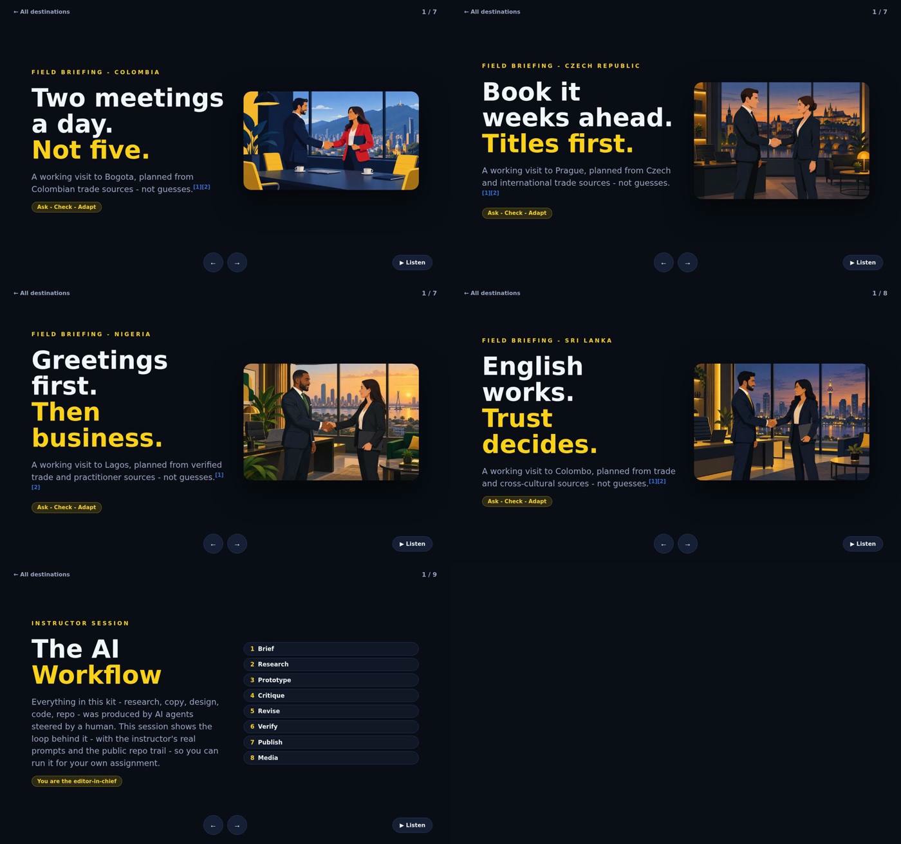

# Business Without Borders - RuniLectures

Interactive teaching kit for the international business course at Reichman University (Arison School of Business).

## Live site

The kit runs at **https://soundguyai.github.io/RuniLectures/** as slide decks with per-slide audio narration (a Listen button on every slide). The site deploys from the `gh-pages` branch; `main` carries the long-form pages.

- [Course kit home](https://soundguyai.github.io/RuniLectures/)
- [Colombia briefing](https://soundguyai.github.io/RuniLectures/colombia/)
- [Czech Republic briefing](https://soundguyai.github.io/RuniLectures/czech-republic/)
- [Nigeria briefing](https://soundguyai.github.io/RuniLectures/nigeria/)
- [Sri Lanka briefing](https://soundguyai.github.io/RuniLectures/sri-lanka/)
- [The AI Workflow - instructor session](https://soundguyai.github.io/RuniLectures/ai-tools/)

## The five sessions

**Colombia - "Two meetings a day. Not five."** A working visit to Bogota, planned from Colombian trade sources - not guesses.

**Czech Republic - "Book it weeks ahead. Titles first."** A working visit to Prague, planned from Czech and international trade sources - not guesses.

**Nigeria - "Greetings first. Then business."** A working visit to Lagos, planned from verified trade and practitioner sources - not guesses.

**Sri Lanka - "English works. Trust decides."** A working visit to Colombo, planned from trade and cross-cultural sources - not guesses.

**The AI Workflow - instructor session.** Everything in this kit - research, copy, design, code, repo - was produced by AI agents steered by a human; this session shows the loop behind it so students can run it for their own assignment.

## What is here

- `index.html` - course kit home: route map and links to every module.
- `colombia/`, `czech-republic/`, `nigeria/`, `sri-lanka/` - interactive country briefings: scenarios with tradeoffs, meeting timelines, calibration strips, pre-flight checklists, and claim-level sources. Each teaches "ask, check, adapt" rather than national rulebooks.
- `ai-tools/` - instructor session on the AI workflow that built this kit (Claude Code, Codex, Cursor, personal assistants, AI video), with the project prompts and review loop documented for students.
- `assets/` - shared design system (`style.css`) and interaction engine (`engine.js`): progress bar, reveals, flip cards, tabs, scenario tradeoff feedback, checklist counter, reduced-motion support.

## Pedagogy

Every cultural claim is tagged to a published source listed at the foot of each page. Cultural guidance describes tendencies, not individuals; students verify against the actual people they meet. Scenarios have no single right answer - each option shows what it buys and what it risks. AI use is disclosed on each page.

## For students

This repo doubles as a template: fork it, replace the content, keep the interaction patterns. See `ai-tools/` for the documented prompt-and-review workflow used to build it.

## Status

Course materials in active development. Narration audio is attached to every briefing (a Listen button on each slide).
